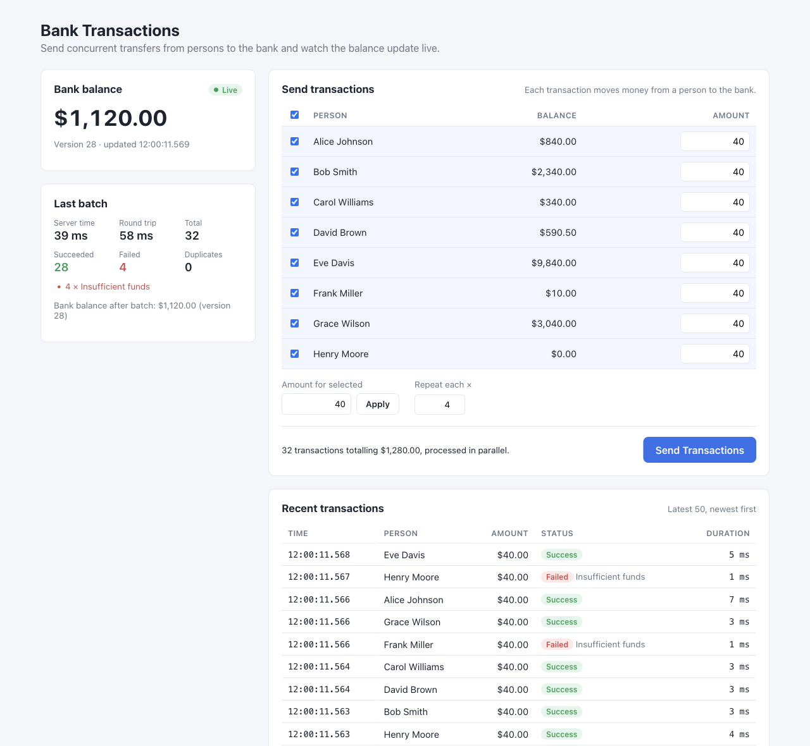

# Bank Transactions

A small full-stack app that simulates many Persons sending money to a single Bank **concurrently**, while keeping every balance correct.

- **Backend**: Nest.js 12, TypeORM 1.x, PostgreSQL 16
- **Frontend**: React 19, Vite, TanStack Query
- **Infra**: Docker Compose (Postgres + backend + nginx-served frontend)



## What it does

- On first start the backend seeds a single **Bank** (balance 0) and 8 predefined **Persons** with balances.
- In the UI you select Persons, give each an amount (or apply one amount to all selected), optionally repeat each transfer N times, and press **Send Transactions**.
- The batch goes to a single endpoint, `POST /api/transactions`, which processes the items **in parallel**. Each item moves money from a Person to the Bank, or fails (insufficient funds, unknown person) without affecting the other items.
- The Bank balance updates **in real time by polling** `GET /api/bank` every 2 s. Person balances and the transaction log are polled the same way. If a poll fails, the balance card shows "Connection problem" until the next one succeeds.
- The UI shows the batch metrics: server processing time, client round-trip time, and success, failure and duplicate counts. It also shows a log of the 50 most recent transactions with their status.


## Running it


### With Docker (recommended)

```bash
docker compose up --build
```

Open [http://localhost:8080](http://localhost:8080). That's all.

- nginx serves the SPA and proxies `/api` to the backend, so the browser only ever talks to one origin.
- Postgres is also published on `localhost:5432` (user, password and database are all `bank`). This is for local inspection and the e2e tests only; do not expose it like this outside development.
- Optional overrides go in `.env`; see [.env.example](.env.example). The host ports can be changed with `FRONTEND_HOST_PORT` and `POSTGRES_HOST_PORT`.


### Locally (for development)

Requires Node 22 or newer and pnpm. The dependencies are recent major versions (Nest 12, TypeORM 1.x, TypeScript 6, Vite 8), so an older Node will fail to install or build.

```bash
docker compose up -d postgres          # or any Postgres 13+ with the env below

cd backend
pnpm install
pnpm start:dev                         # http://localhost:3000

cd ../frontend
pnpm install
pnpm dev                               # http://localhost:5173, proxies /api to BACKEND_URL (default http://localhost:3000)
```

The backend reads these environment variables. All of them have defaults that match `docker compose up -d postgres`:

| Variable | Default | Meaning |
| --- | --- | --- |
| `PORT` | `3000` | HTTP port |
| `DB_HOST`, `DB_PORT`, `DB_USER`, `DB_PASSWORD`, `DB_NAME` | `localhost`, `5432`, `bank`, `bank`, `bank` | Postgres connection |
| `DB_POOL_SIZE` | `10` | Connection pool size |
| `TX_CONCURRENCY` | `8` | Transfers processed at the same time; capped below the pool size |
| `CORS_ORIGIN` | `http://localhost:5173,http://localhost:8080` | Comma-separated allowed origins |


### Tests

```bash
cd backend
pnpm test        # unit: money parsing/formatting, bigint transformer, request hash, concurrency limiter
pnpm test:e2e    # needs Postgres on localhost:5432; drops and recreates a dedicated `bank_e2e` database

cd ../frontend
pnpm test        # pure reducer: versioned bank balance; money helpers
```

The e2e suite boots the real `AppModule` against an empty database. It covers:

- **Money is conserved**: the sum of Person balances plus the Bank balance never changes.
- **Bank growth matches successes**: `Δ bank balance = Σ amounts of SUCCESS rows`.
- **Per-Person debits are exact**: each Person loses exactly the sum of their own successful transfers, and failed transfers change nothing.
- **No overdraft**, including when the same Person is repeated inside one batch.
- **Exactly one row per item**.
- **Version tracks successes**: `Δ version = count(SUCCESS)`.
- **Idempotency**: concurrent duplicate requests, a reused key with a different payload (422), FAILED being final, reconciliation of a partially processed batch, and an invalid key (400).
- **Validation edge cases** for the request body and the `limit` query parameter.


## API

All money values are **decimal strings** (`"1234.56"`). `version` is a bigint as a decimal string.

### `POST /api/transactions`

Processes a batch of Person-to-Bank transfers in parallel.

```http
POST /api/transactions
Content-Type: application/json
Idempotency-Key: 3f1c8a52-6a7e-4c1b-9d55-0c1f2a9e7b10   (optional, must be a UUID)

{ "transactions": [ { "personId": "<uuid>", "amount": "25.00" }, ... ] }
```

- 1 to 200 items.
- `amount` must be a string matching `^\d{1,12}(\.\d{1,2})?$` and greater than 0.
- Unknown fields are rejected.


| Status | Meaning                                                                                |
| ------ | -------------------------------------------------------------------------------------- |
| `200`  | Batch processed. This includes partial or total business failure; see `results[]`.     |
| `400`  | Invalid body or invalid `Idempotency-Key`. Nothing is processed.                       |
| `422`  | The `Idempotency-Key` was already used with a different payload. Nothing is processed. |


```json
{
  "batchId": "…", "durationMs": 52, "total": 40, "successCount": 34, "failureCount": 6, "duplicateCount": 0,
  "bankBalance": "895.50", "bankVersion": "41",
  "results": [
    { "itemIndex": 0, "transactionId": "…", "personId": "…", "amount": "25.00",
      "status": "SUCCESS", "failureReason": null, "durationMs": 3, "duplicate": false, "recorded": true }
  ]
}
```

- `failureReason` is one of `INSUFFICIENT_FUNDS`, `PERSON_NOT_FOUND` or `INTERNAL_ERROR`.
- `duplicate: true` means the result was already stored by an earlier request with the same key.
- `recorded: false` (very rare) means the failure could not be persisted, for example because the DB connection was lost.


### Read endpoints

- `GET /api/bank` returns `{ balance, version, updatedAt }`.
- `GET /api/persons` returns `[{ id, name, balance }]`.
- `GET /api/transactions?limit=50` returns the most recent transactions, ordered `createdAt DESC, id DESC`. `limit` is an integer from 1 to 200 and defaults to 50.


## Design choices


### Architecture

The Nest modules are split by feature. `bank` and `persons` only expose reads. `transactions` is the use case: processing one item writes the `persons`, `transactions` and `bank` rows inside a single database transaction, so that transaction never has to be passed between modules. Each item gets its own transaction (see below), so a batch is many independent transactions, not one.

There is no separate database layer. The queries that move money stay next to the code that depends on their exact outcomes. The design favours keeping that money path short and easy to follow over adding layers.

The frontend follows the same split: the HTTP client, a pure state reducer, hooks and components stay apart. It uses React 19 and Vite, with TanStack Query for server state and polling.


### Correctness under concurrency

Each item runs in its **own DB transaction**, so one failing item never rolls back the others. Inside each transaction:

1. **Atomic conditional debit**: `UPDATE persons SET balance = balance - $1 WHERE id = $2 AND balance >= $1`. If no row is updated, the transfer is rejected. There is no read-modify-write in application code, so concurrent transfers cannot cause lost updates or overdrafts. Two transfers for the same Person serialize on that Person's row lock, and the second one re-checks the balance after the first commits.
2. **Insert the SUCCESS row**. A unique constraint on `(batch_id, item_index)` detects duplicates here, *before* the Bank row is touched.
3. **Credit the Bank last**: `UPDATE bank SET balance = balance + $1, version = version + 1`. Locks are always taken in the same order (Person row, then index entry, then Bank row), so a deadlock cycle cannot form. Touching the single hot Bank row last keeps its lock held for as short a time as possible.

Defense in depth: `CHECK (balance >= 0)` on Persons and the Bank, and `CHECK (id = 1)`, which makes a second Bank row impossible.

**Bounded parallelism.** A semaphore shared across all requests (`TX_CONCURRENCY`, default 8, capped below the pool size of 10) keeps parallel transactions from exhausting the Postgres connection pool.

**Realistic concurrency.** Every successful transfer updates the same Bank row, so successful transfers serialize on that row's lock whatever `TX_CONCURRENCY` is set to. Several things still run in parallel: debits on different Persons, the duplicate checks, failures (which never touch the Bank), and network and pool work. Going beyond that would need an append-only ledger with an aggregated balance, or sharded Bank sub-balances that are summed on read.

### Money

- Balances and amounts are stored as **integer cents in** `bigint` **columns**. A TypeORM transformer maps them to JS `bigint`, never `number`, so precision is never lost.
- The API accepts and returns **decimal strings**. Parsing (`"12.3"` to `1230n`) is done on the string, with no float math anywhere. The UI formats the strings with `Intl.NumberFormat` and sums them in `bigint` cents.
- **One currency only** (USD, a single constant in `frontend/src/config.ts`).
- **Overflow is not a practical concern.** Transfers conserve money, so the Bank can never hold more than the total seeded supply, which is many orders of magnitude below the `bigint` limit.


### Failures are persisted correctly

- A rejected transfer throws a typed error inside its transaction, which rolls it back. The **FAILED row is written afterwards, in a separate statement**, so the rollback cannot erase it.
- A FAILED row is stored even for an unknown `personId`, because `transactions.person_id` deliberately has no foreign key. The log records what was *requested*.
- If even that insert fails, the error is logged and the API still returns `FAILED` with `recorded: false`.


### Idempotency

- **One final row per item.** Every `(batchId, itemIndex)` has at most one row, and that stored row is the item's final result. A request that loses a race (a unique violation, or `ON CONFLICT DO NOTHING` returning nothing) reads the stored row and returns it with `duplicate: true`.
- **SUCCESS and FAILED are both final for a key.** A retry returns the original outcome, even if the Person has been topped up since; this is standard idempotency-key semantics. The UI generates a new key for every click and reuses it only for its own automatic retries of network errors and 5xx responses.
- **The key is claimed before any work starts**, using `INSERT ... ON CONFLICT DO NOTHING` into `transaction_batches` together with a sha256 hash of the canonical payload. A reused key with a different payload gets `422`. The primary key also catches two concurrent first-time requests that use the same key with different payloads.
- **Partially processed batches are finished on retry.** If a batch was interrupted (for example by a crash), the retry processes only the items without a stored row and returns the others as duplicates. The response always carries whole-batch stats.


### Real-time updates

- **Polling, as the task specifies.** The balance, the Person balances and the transaction log are refetched every 2 s with TanStack Query (`POLL_INTERVAL_MS` in `frontend/src/config.ts`). There is no push channel, which keeps the backend a plain REST API.
- **Versioned balance.** `version` comes from the same `UPDATE` that changed the balance. The client applies a balance only if its version is newer than the one it already shows, so a slow or out-of-order poll response is harmless.
- **No waiting for the next poll after a batch.** The batch response carries the resulting balance, shown in the "Last batch" card, and the Bank balance, Person balances and transaction log are all refetched as soon as a batch settles.


### Timing

- **Batch** `durationMs` runs from the moment the request is handled until every item has settled.
- **Item** `durationMs` runs from when the item gets a concurrency slot until its DB transaction has committed or finished rolling back.


### Seeding

- Seeding runs in `onApplicationBootstrap`, after TypeORM `synchronize` has created the tables.
- It runs in one transaction under `pg_advisory_xact_lock`. The Bank is inserted with `ON CONFLICT DO NOTHING`, and Persons are seeded only if this run actually inserted the Bank.
- Restarts, and several instances starting at the same time, therefore never duplicate data.


## Project layout

```
backend/src
  bank/           singleton Bank entity, GET /api/bank
  persons/        Person entity, GET /api/persons
  transactions/   Transaction + TransactionBatch entities, DTOs, the batch processor, controller
  seed/           race-safe seeding on bootstrap
  common/         money (cents parsing/formatting, bigint transformer, validator), limiter, pg errors, request hash
  config/         env-driven configuration and TypeORM options
backend/test      e2e suite (real Postgres)
frontend/src
  api/            typed REST client
  state/          pure reducer (versioned balance), unit tested
  hooks/          useBank, useTransactionLog, usePersons, useSendTransactions
  components/     BankBalanceCard, PersonSelector, TransferForm, BatchResult, TransactionLog
```


## Known limitations and possible improvements

- **Polling latency and load.** The UI can lag the database by up to 2 s, and every open tab issues three requests per interval. Server-sent events or WebSockets would remove both, at the cost of a push channel to maintain.
- `synchronize: true` is an assignment requirement. Production would use migrations, and the named CHECK constraints (`CHK_person_balance_non_negative`, `CHK_bank_balance_non_negative`, `CHK_bank_singleton`) would have to be carried over explicitly. `synchronize` itself can race when several instances start at once.
- **Throughput is bounded by the Bank row lock**; see "Realistic concurrency" above.
- **The transaction list has no pagination.** It only shows the latest 50 entries, and the API returns at most 200.
- **There is no authentication or rate limiting** (for example `@nestjs/throttler` on `POST`). Idempotency keys are not scoped to an owner and never expire. UUIDv4 keys are not guessable in practice, but with auth they would be scoped per user.

